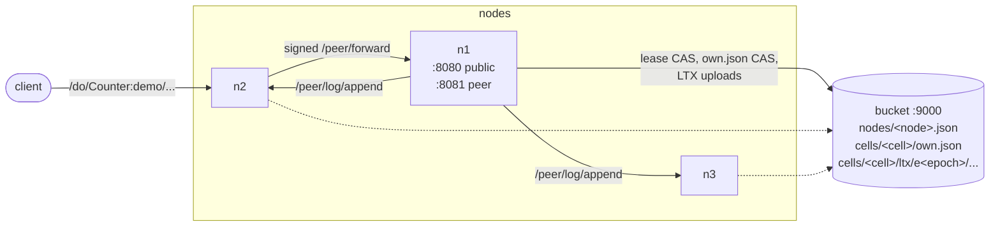
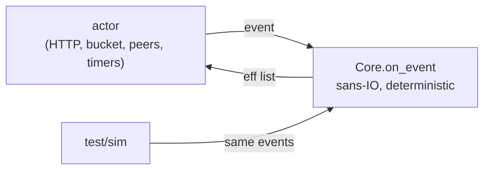
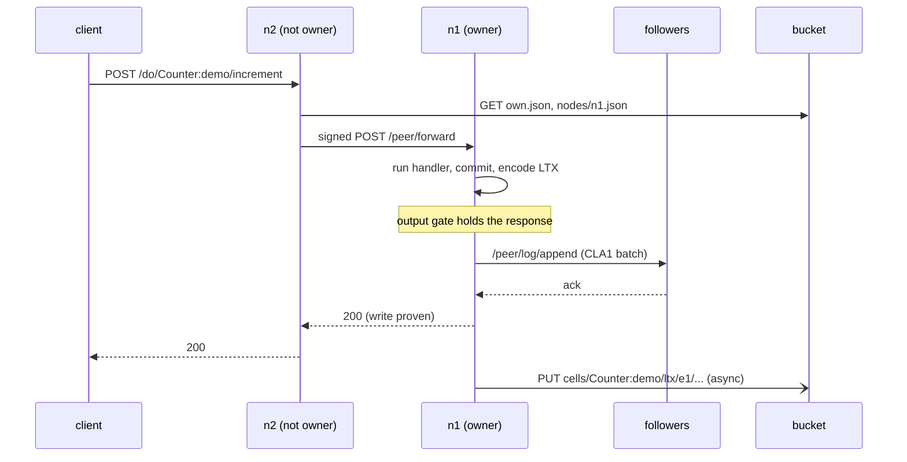
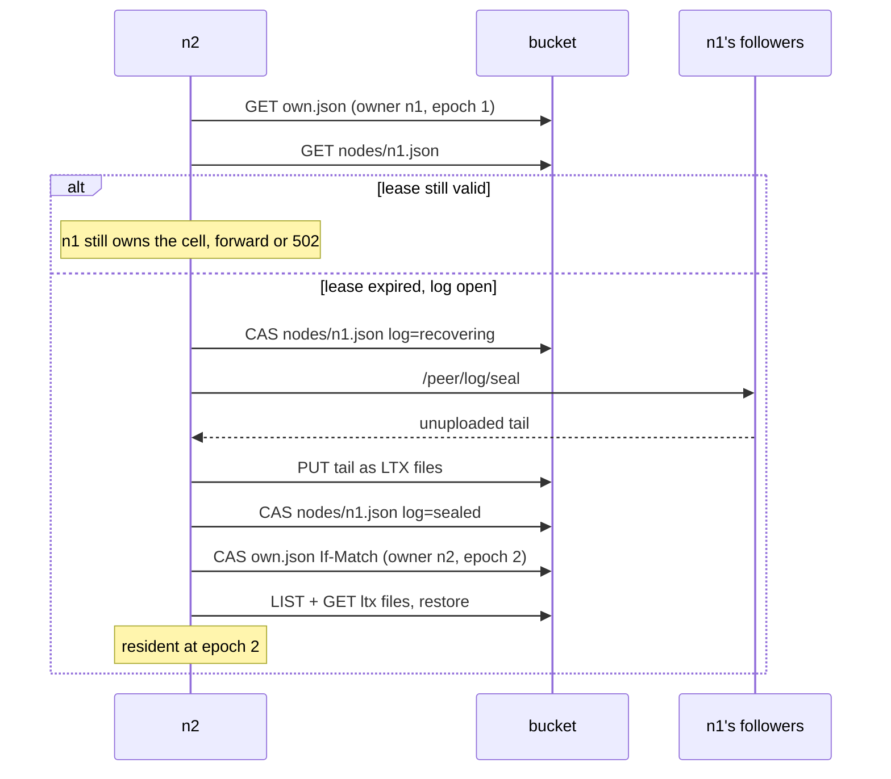
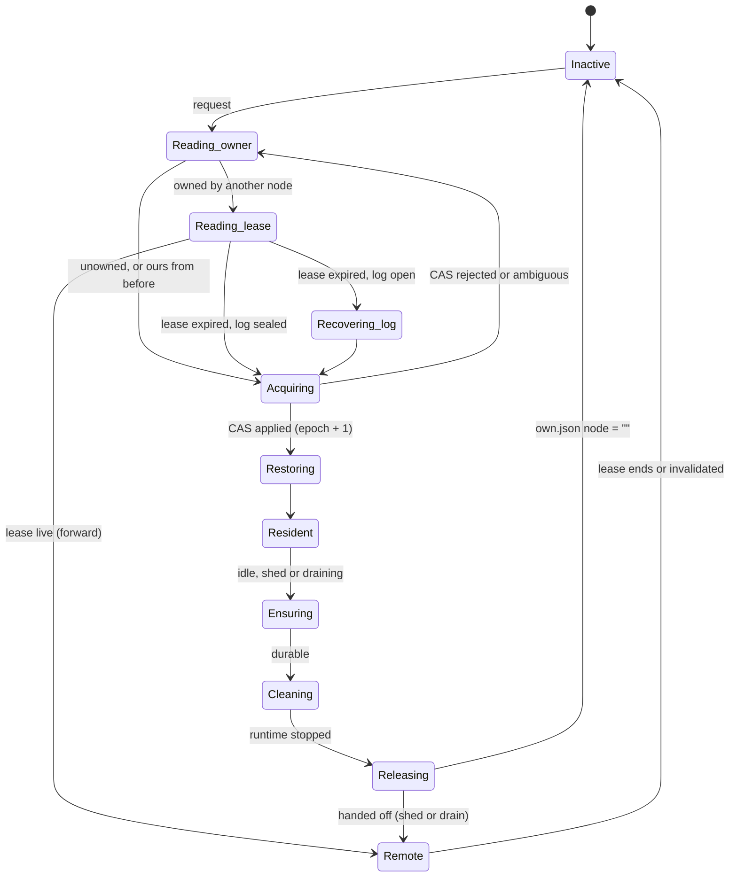

# celld-ml

A slop-fork of [denoland/celld](https://github.com/denoland/celld)'s
architecture in OCaml. Each node, and the bucket, runs as a MirageOS
unikernel on Solo5 `hvt` (KVM).

celld runs distributed Durable Objects with no consensus service. A *cell*
is a named object. A conditional write in an object-store bucket makes
exactly one node its owner, and every committed write is captured as an LTX
file. This fork keeps that design. Cells of any class you deploy run
JavaScript on QuickJS, with a Durable Object-style `ctx.storage` backed by
the cell's own SQLite database. `Sql:` cells expose SQLite directly, and
`Counter:` and `Kv:` cells are native OCaml handlers. All of it runs inside
the unikernel. See [DESIGN.md](DESIGN.md) for the mapping.

## How it fits together

Every box is its own Solo5 unikernel. Clients can hit any node; the bucket
is the only shared state.



Inside a node, one pure function decides and an actor does the I/O:



### A write

The owner commits, ships the LTX entry to its followers, and only answers
once every follower has acked (fleet proof). The upload to the bucket
happens afterwards.



### Takeover after an owner dies



### Cell lifecycle on a node



A node that cannot renew `nodes/<node>.json` before it expires halts with
exit code 3, so a partitioned owner stops serving before anyone else can
claim its cells.

## What carries over

- **The sans-IO core.** `Celld_logic.Core.on_event : t -> now_ms:int -> event -> eff list`
  is the only thing that changes behavioral state. The unikernel is a serial
  actor that executes the effects and turns their completions into events.
  The deterministic simulator in `test/sim` drives the same function.
- **Ownership by conditional write.** `cells/<cell>/own.json` is claimed with
  `If-None-Match: *` or `If-Match`, and every activation advances the epoch.
  An ambiguous CAS is re-read and never retried blind.
- **Node leases and self-fence.** `nodes/<node>.json` is CAS-renewed every
  ttl/3. A node that can't renew before expiry halts with exit code 3.
- **LTX capture.** The file format follows celld's `ltx-format.md`: LZ4
  pages, CRC-64/GO-ISO and rolling checksums. Files land under
  `cells/<cell>/ltx/e<epoch>/...`. Each epoch opens with a snapshot, and the
  epoch prefix is the fence.
- **Compaction and epoch GC.** Every `--compact-every` commits (default
  64) the owner uploads a level-1 snapshot and deletes the files it
  covers. When a cell is stopped, files from older epochs are deleted.
  Restore reads the newest snapshot of the newest epoch plus what follows
  it.
- **The output gate.** A response that reveals a write is held until the
  write is proven. Reads trail the newest open barrier on their cell.
- **Fleet vs bucket proofs.**
  - A fleet proof is an ack from every recruited follower over signed peer
    HTTP. A follower writes the batch to its own block device before it
    acks, so an acked entry survives the follower restarting.
  - A bucket proof is an upload plus an `own.json` re-read.
- **The takeover recovery gate.** Before taking over a cell from a dead
  owner whose log is open, the new node:
  1. CASes that node's log record to `recovering`;
  2. seals its followers;
  3. uploads their tails;
  4. CASes the record to `sealed`.
- **Rebalance and drain.** Each lease carries the node's resident cell
  count. A node more than one cell above the fair share marks its excess
  cells to move. Each one is handed off when it goes quiet: made durable,
  stopped, released, and then activated on the target (`/peer/activate`).
  Requests that arrive meanwhile wait and follow the cell.
  `POST /.well-known/celld/drain` stops a node from taking ownership and
  hands off every cell. Once its log is in the bucket, the node writes an
  expired lease with no open log and exits 0, so no one has to recover it.
- **SQLite cells.** `Sql:<id>` cells run SQLite 3.54.1 (fetched
  amalgamation) inside the unikernel. It is built without threads or an OS
  layer and uses an in-memory VFS that records which pages each write
  touches. Those pages become the commit's LTX file, the same pages celld
  captures from SQLite's WAL. `POST /do/Sql:<id>/query` runs the body as SQL
  and returns the last result set as JSON, and `GET /` lists the tables. A
  request that leaves a transaction open is rolled back, so each commit is
  one request.
- **JS cells.** Every class other than `Counter`, `Kv` and `Sql` is a script
  stored in the bucket at `classes/<Class>.js`. Deploy one with
  `PUT /.well-known/celld/classes/<Class>`. Each resident cell gets its own
  QuickJS context: the engine is interpreter-only, single-threaded C, so it
  runs where V8 cannot. A script defines `fetch(request, ctx)` and optionally
  `alarm(ctx)`, and may return a `Response`, a string, a JSON value or a
  promise. `ctx.storage.sql.exec(query, ...bindings)` runs SQL on the cell's
  SQLite database. `ctx.storage.get/put/delete/list` are a KV on top of it.
  Each call runs in a savepoint, so a handler that throws leaves no writes.
  Every call has an instruction budget and the runtime has a memory limit,
  so a runaway script fails without stalling the node.
  [examples/chat.js](examples/chat.js) is a chat room.
- **Workers APIs, with I/O.** QuickJS cannot block, so a call that awaits
  I/O suspends with a list of operations. The node performs them and
  resumes the call, and one savepoint covers the call across every wait.
  On top of that, each with a 30 s deadline and at most 50 per call:
  - **Outbound fetch.** `fetch()` uses `Request`, `Response` and `Headers`
    with binary bodies. TLS is checked against the Mozilla root store.
    Hostnames resolve through a built-in DNS client (`--dns`). Cells can
    never reach the bucket or the peer port, and private addresses are
    refused unless `--fetch-private` is set.
  - **Cell stubs.** `ctx.cell("Class:id").fetch(path, init)` calls another
    cell, Durable Object style, wherever it lives.
  - **D1.** `ctx.d1(name)` is a SQL database in its own `D1:<name>` cell,
    with `prepare().bind().all/first/run/raw` and transactional `batch`.
  - **R2.** `ctx.r2(bucket)` stores objects in the fleet's bucket under
    `r2/<bucket>/`, with `get/head/put/delete/list` and metadata.
  - **Workflows.** `ctx.workflow(Class).create({ id, params })` starts a run
    of the class's `run(event, step, ctx)` in `<Class>:wf-<id>`.
    `step.do(name, [config], fn)` is memoized, and a failed step rolls back
    its writes and retries with backoff. `step.sleep` and
    `step.sleepUntil` suspend the run until its alarm.
  - **The rest:** timers (`setTimeout`, `setInterval`), `ctx.waitUntil`
    (finished before the response leaves), `crypto.getRandomValues`,
    `randomUUID`, `subtle.digest` and HMAC
    `importKey`/`generateKey`/`sign`/`verify` (from the node's CSPRNG and
    digestif), `URL`, `URLSearchParams`, `TextEncoder`, `TextDecoder`,
    `atob`, `btoa`, `console`, `structuredClone`, `queueMicrotask` and a
    minimal `ReadableStream`.

  [examples/workers.js](examples/workers.js) tours all of it.
- **Rolling deploys.** Each resident JS cell records which deployment (the
  script's etag) it runs. A deploy is announced to the peers, and every
  node also rechecks the classes of its resident cells. A cell switches to
  new code before its next event. Calls are serial, so none is in flight
  then, and the cell keeps its epoch, storage and WebSockets. `/state`
  shows each cell's deployment.
- **Memory-pressure and residency shedding.** With `--max-memory-mb` (cell
  memory: the OCaml heap, SQLite pages and per-cell JS heaps) or
  `--max-resident-cells`, a node over budget releases its least recently
  used idle cells. Idle means no socket and no handler running. They
  reactivate on their next request.
- **Queues.** A queue is a cell (`Queue:<name>`) holding its messages in
  SQLite. A JS cell sends with `ctx.queue(name).send(body, { delaySeconds })`
  or `sendBatch`. The message goes into the sender's own outbox in the same
  commit as the rest of the request, and the node delivers it once that
  commit is durable. A queue therefore never holds a message from a request
  that failed, and `send()` returns before delivery (celld waits for the
  queue's commit). `PUT /.well-known/celld/queues/<name>` sets the consumer
  class and celld's settings: `max_batch_size`, `max_batch_timeout_ms`,
  `max_retries`, `retry_delay_ms` and `dead_letter_queue`. The consumer's
  `queue(batch, ctx)` runs in `<Class>:__consumer` with `ack()`, `retry()`,
  `ackAll()` and `retryAll()`. Delivery is at least once and keeps
  message ids, and messages are kept for 4 days. A handler that throws has
  its writes rolled back and its whole batch retried.
  [examples/queues.js](examples/queues.js).
- **Cron triggers.** `PUT /.well-known/celld/classes/<Class>/crons` takes
  newline-separated expressions in Cloudflare's dialect (UTC, weekdays 1-7
  from Sunday, plus `L`, `W` and `#` forms). The class's `<Class>:__cron` cell
  runs `scheduled(controller, ctx)` once per occurrence across the fleet,
  driven by its alarm. A failure retries after 4 s, doubling, at most six
  times and never past the next occurrence, unless the handler calls
  `controller.noRetry()`. After downtime one missed occurrence runs.
  [examples/cron.js](examples/cron.js).
- **Alarms.** `PUT /do/<cell>/__alarm?in_ms=N` (or `?at_ms=T`) sets the
  cell's one alarm, and `GET` or `DELETE` read or clear it. The alarm is a
  key in the cell's own state, so it is captured, replicated and moves with
  the cell. The owner fires it as an ordinary write that runs the class's
  alarm handler (Counter ticks, Kv counts firings). The bucket index
  `alarms/<cell>` lets any node wake a cell that was evicted or whose
  owner died. A fire that finds nothing due is a no-op.
- **Any S3-compatible bucket, over TLS.** `--bucket=s3://IP:PORT/BUCKET`
  makes the nodes use a real object store instead of the bucket unikernel.
  Requests are path-style and SigV4-signed (`--s3-region`). The keys are
  never arguments: they are `s3_access_key=` and `s3_secret_key=` lines on
  a small `secrets` block device, which `fleet.sh` writes from
  `S3_ACCESS_KEY` and `S3_SECRET_KEY` as a file only you can read. Listing
  uses ListObjectsV2, and
  ownership still rests on `If-None-Match: *` and `If-Match` on PUT, which
  S3 and its clones now support. `--s3-tls=true` uses TLS (ocaml-tls).
  The certificate is checked against the Mozilla root store, or pinned
  with `--s3-tls-fingerprint`. The unikernel has no DNS, so the endpoint is
  an IP and `--s3-host` sets the Host header and TLS name.
- **WebSockets.** A JS cell accepts sockets with the Durable Object
  hibernation API: `new WebSocketPair()`, `ctx.acceptWebSocket(server, tags)`,
  `ctx.getWebSockets(tag)`, `ws.send()`, `ws.close()` and
  `serializeAttachment`. Its `webSocketMessage(ws, message, ctx)` and
  `webSocketClose(ws, code, reason, wasClean, ctx)` run as ordinary events
  through the cell, one at a time per socket. Sends leave only after the
  event's writes are durable. The owner node terminates the socket, and a
  client that reached another node is relayed byte for byte over a tunnel.
  Open sockets keep their cell resident. When the cell moves (drain or
  rebalance), the sockets close with 1012 so clients reconnect, as in celld.
  [examples/room.js](examples/room.js).
- **The peer tunnel.** Peer calls travel through a pooled TLS connection to
  each peer, upgraded once with a signed `POST /peer/tunnel`. After that it
  carries keep-alive HTTP, so a forwarded request costs no new handshake. A
  pooled tunnel the peer closed while idle is retried on a fresh one, since
  the request never reached it.
- **Encrypted, signed peer traffic.** The peer port (8081) speaks TLS 1.3
  with a fleet identity: the first node creates a P-256 key and a
  self-signed certificate in `fleet/peer-tls.json` with a conditional write,
  and every node serves with it and pins it when calling peers. Requests
  are also HMAC-SHA256-signed with a fleet secret created the same way.
  Whoever can read the bucket can impersonate the fleet either way, so the
  bucket stays the root of trust. The protocol version is 6, so nodes
  without peer TLS are not recruited.

Compared with celld, celld-ml lacks the Node.js compatibility layer,
WebAssembly, HTMLRewriter, the Cache API, Web Crypto beyond random
values, digests and HMAC, streams beyond a minimal `ReadableStream`, and
service bindings between Workers (cells reach each other through
`ctx.cell`). A cell also runs one event at a time, even across awaits;
celld interleaves at awaits.

## Layout

| path | what |
|---|---|
| `lib/logic` | the core: types, phases, `on_event` |
| `lib/ltx` | the LTX format, CRC-64, and an LZ4 block codec written from the format spec |
| `lib/cell` | the page store (KV or SQLite), capture, restore planning, GC, and the cell classes |
| `lib/ws` | WebSocket handshake and frames (RFC 6455), checked against the RFC's examples |
| `lib/cron` | Cloudflare-dialect cron expressions: parsing, next occurrence, catch-up |
| `lib/s3` | SigV4 signing (checked against AWS's published examples), key encoding, ListObjectsV2 parsing |
| `lib/js` | the JS cell runtime over QuickJS 2026-06-04 (fetched by `scripts/fetch-vendor.sh`): the Solo5 shims it needs, prelude, storage binding, budgets |
| `lib/sqlite` | SQLite 3.54.1 (fetched by `scripts/fetch-vendor.sh`), an in-memory VFS with dirty-page tracking, limits, and the OCaml binding |
| `lib/wire` | JSON records, the `CLA1` log batch, and peer signing helpers |
| `lib/http`, `lib/http/mirage`, `lib/bucketc` | HTTP/1.1, plus server and client over mirage-tcpip, plus the bucket client |
| `unikernels/bucket` | an S3-like object store with ETag CAS, persisted to a block device |
| `lib/blocklog`, `lib/blocklog/mirage` | a crash-safe record log on a block device: two halves and a superblock, compacted by rewriting the live records into the other half |
| `unikernels/node` | the node: actor, effect executor, node log, follower log, and peer endpoints |
| `test/*` | native tests and the simulator |

## Run it

Everything runs inside a Lima VM, because Solo5 needs Linux and KVM. On an
M3 or newer Mac, nested virtualization provides `/dev/kvm`.

```bash
limactl create --name=mirage --vm-type=vz --cpus=6 --memory=4 --set='.nestedVirtualization=true | .mounts=[{"location":"~/Github/Personal/celld-ml","writable":true}]' template:ubuntu
```

Inside the VM, install opam, an OCaml 5.3 switch named `mirage`, and the
`mirage`, `dune`, `solo5` and `ocaml-solo5` packages. Then:

```bash
scripts/build.sh bucket && scripts/build.sh node   # fetches SQLite and QuickJS, ships stripped images
scripts/fleet.sh up 3                  # bucket at 10.0.0.2, nodes n1..n3 at 10.0.0.11..13
curl -X POST http://10.0.0.11:8080/do/Counter:demo/increment
curl http://10.0.0.12:8080/do/Counter:demo          # forwarded to the owner
curl -X PUT --data-binary hi http://10.0.0.13:8080/do/Kv:cfg/greeting
curl http://10.0.0.11:8080/state
scripts/fleet.sh down
```

Against an S3-compatible store instead of the bucket unikernel:

```bash
S3_ACCESS_KEY=KEY S3_SECRET_KEY=SECRET NODE_BUCKET=s3://10.0.0.1:9100/celld scripts/fleet.sh up 3
```

`build.sh` patches two vendored dependencies:

- **Lwt:** its optional `runtime_events` support is removed, because it
  needs `fstat`, which Solo5 doesn't provide.
- **mirage-crypto:** a failing timer-entropy self-test is non-fatal instead
  of aborting boot. The arm64 counter is too coarse under nested
  virtualization, so back-to-back reads return the same value.

Lwt is also pinned below 6, which crashes under mirage-solo5.

Native tests:

```bash
scripts/fetch-vendor.sh
dune build @runtest --root . --build-dir _build_all
```

## Observed on the fleet

- **Fleet-acknowledged writes:** 5–20 ms per acknowledged write, with
  forwarding through non-owners working.
- **Takeover with stalled uploads:** n1 was restarted with
  `--upload-delay-ms=600000` and acknowledged 10 writes that only its
  followers held. After a `SIGKILL`, n2 refused to take over while n1's
  lease was still valid. After the lease expired, n2 sealed n1's log on both
  followers, uploaded all 10 entries, claimed epoch 2 and restored the value
  10. No acknowledged write was lost.
- **Every node crashes at once:** with n1's uploads stalled, 10 writes
  were acked by n1 and held only by its followers. All three nodes were
  killed and n2 and n3 restarted. Each replayed its follower log from disk
  (`holding 10 entries`), and n2 recovered n1's log and restored 10. With
  a 256 KB log disk and 400 writes, each follower compacted twice and all
  400 came back.
- **Compaction:** 150 writes left one level-1 snapshot plus 22 files
  instead of 150. After a takeover the new owner restored 150 from them,
  and after it went idle the cell was down to a single file.
- **Rebalance and drain:** n1 restarted holding all 9 cells and spread
  them 3/3/3 within one discovery round. Draining n2 then moved its 3 cells
  to n1 and n3, and n2 exited with code 0. All 9 counters kept their
  values.
- **SQLite:** a `Sql:` cell took 40 inserts forwarded from other nodes
  and refused a request that left a transaction open. It compacted from 18
  files to 1 snapshot plus a few, and after its owner was killed the new
  owner restored all 40 rows at e2.
- **JS cells:** the `Chat` class from `examples/chat.js` was deployed through
  n1 and took messages through n2 and n3. A message that made the handler
  throw left no row behind, the JS alarm ran, and after the owner was
  killed the next node restored the room with its messages, KV entries and
  alarm count.
- **S3 and TLS:** with moto's S3 server as the bucket (MinIO's community
  build is no longer distributed), the fleet ran writes, compaction and GC,
  an alarm, a JS class and a takeover with no state lost. The same ran over
  HTTPS with a pinned certificate. A node given the wrong pin refused the
  store (`authentication failure: fingerprint`) and served nothing.
- **Peer TLS:** a packet capture of a forwarded write showed 358 packets
  of TLS records on port 8081 and none of the request's plaintext, and a
  takeover recovered the dead owner's log over TLS.
- **Workers APIs:** with dnsmasq and a small HTTP server on the bridge,
  these all worked across three nodes: a cell fetched `upstream.test`, was
  refused the bucket, and computed SHA-256 and a UUID. It also ran D1
  batches from two cells, stored and listed R2 objects, called a `Counter`
  and another JS cell through stubs, slept on a timer and finished
  `waitUntil` work. A workflow waited out its sleep, retried a step that
  failed on attempt 1, and completed with its memoized results.
- **Rolling deploy:** a resident cell answered "version 1", the class was
  redeployed through another node, and the same cell, still at e1,
  answered "version 2".
- **Shedding:** with a cap of 6, a node holding 13 cells shed its idle ones
  down to the cap (alongside rebalancing), and a shed cell answered its
  next request.
- **WebSockets:** two clients joined a room through n1 and n2 while n3 owned
  it, so both were relayed over tunnels. Messages reached both, ping and
  close were answered, and draining n3 closed the remaining socket with
  1012. The room's history, written by socket events, was intact on the
  node that took over.
- **Queues and cron:** 7 orders from three nodes reached the consumer in
  batches of 5 and 2. An order whose handler threw was tried 3 times
  (`max_retries` 2) and moved to the dead-letter queue. The heartbeat cron
  ran on two consecutive minute boundaries. Runtime paths get 403 on the
  public port.
- **Alarms:** an alarm fired on its owner's timer, an alarm on a cell
  evicted 5 s earlier woke it at e2 and fired once, and an alarm whose
  owner was killed fired on the node that took over. The `alarms/` index
  was empty afterwards.
- **Partition:** a node cut off from the bucket logged
  `SELF-FENCE: node lease expired` and exited with code 3, and another node
  took over its cell at the next epoch with its state intact.
- **Idle eviction:** an idle cell is made durable, stopped, and its
  ownership released (`node: ""`). The next request reactivates it at
  epoch+1.

## License

Apache-2.0; see [LICENSE](LICENSE) and [NOTICE](NOTICE). The design and the
LTX format come from [celld](https://github.com/denoland/celld) (Apache-2.0).
