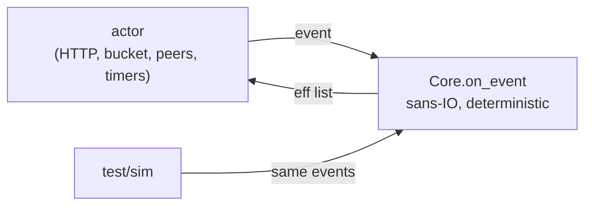
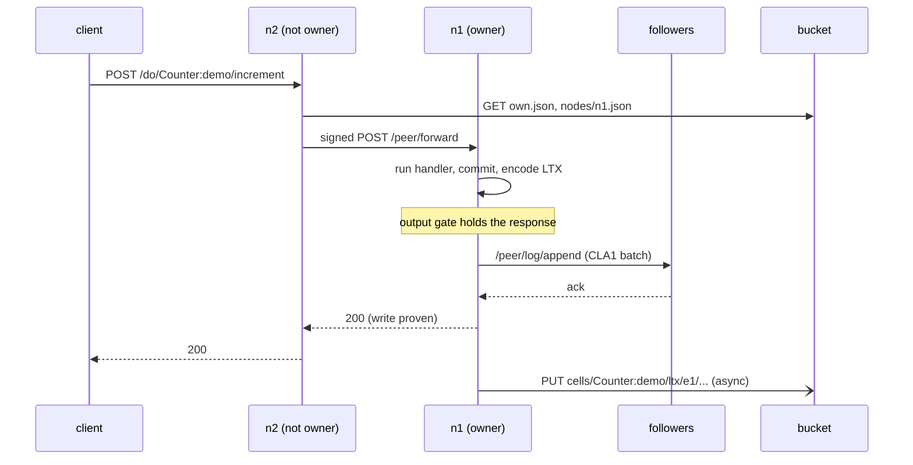
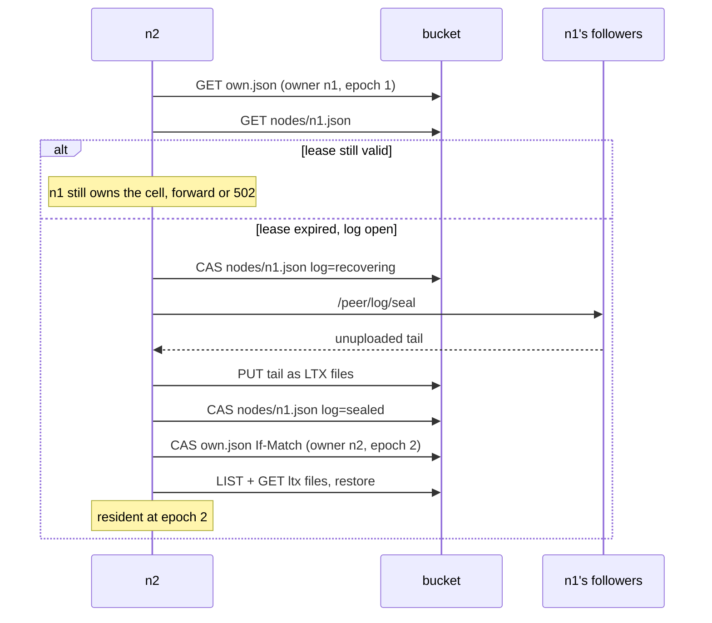
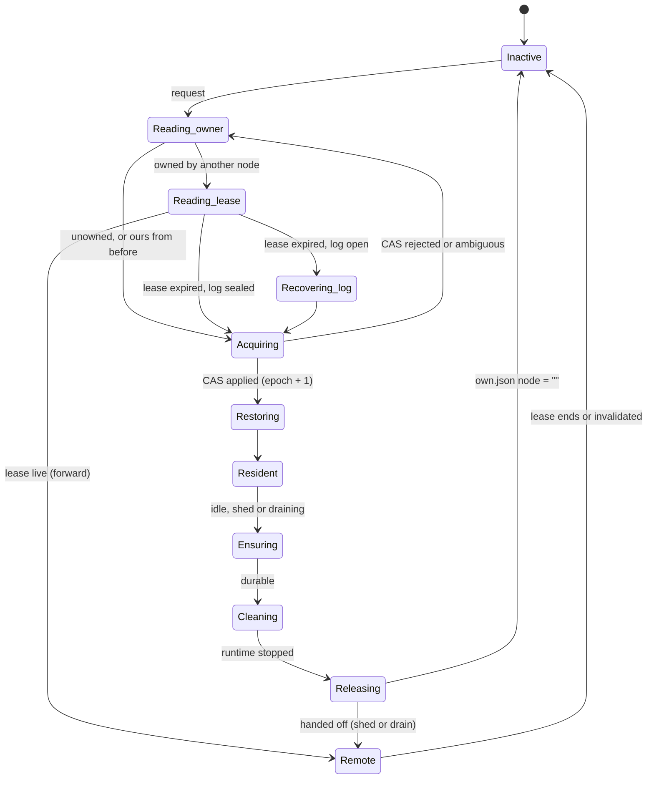

# celld-ml

A slop-fork of [denoland/celld](https://github.com/denoland/celld)'s
architecture in OCaml. Each node, and the bucket, runs as a MirageOS
unikernel on Solo5 `hvt` (KVM).

celld runs distributed Durable Objects with no consensus service. A *cell*
is a named object. A conditional write in an object-store bucket makes
exactly one node its owner, and every committed write is captured as an LTX
file. This fork keeps that design. Cells of any class you deploy run
JavaScript on QuickJS, with a Durable Object-style `ctx.storage` backed by
the cell's own SQLite database. `Sql:` cells expose SQLite directly, and
`Counter:` and `Kv:` cells are native OCaml handlers. All of it runs inside
the unikernel. See [DESIGN.md](DESIGN.md) for the mapping.

## How it fits together

Every box is its own Solo5 unikernel. Clients can hit any node; the bucket
is the only shared state.


Inside a node, one pure function decides and an actor does the I/O:



### A write

The owner commits, ships the LTX entry to its followers, and only answers
once every follower has acked (fleet proof). The upload to the bucket
happens afterwards.



### Takeover after an owner dies



### Cell lifecycle on a node



A node that cannot renew `nodes/<node>.json` before it expires halts with
exit code 3, so a partitioned owner stops serving before anyone else can
claim its cells.

## What carries over

- **The sans-IO core.** `Celld_logic.Core.on_event : t -> now_ms:int -> event -> eff list`
  is the only thing that changes behavioral state. The unikernel is a serial
  actor that executes the effects and turns their completions into events.
  The deterministic simulator in `test/sim` drives the same function.
- **Ownership by conditional write.** `cells/<cell>/own.json` is claimed with
  `If-None-Match: *` or `If-Match`, and every activation advances the epoch.
  An ambiguous CAS is re-read and never retried blind.
- **Node leases and self-fence.** `nodes/<node>.json` is CAS-renewed every
  ttl/3. A node that can't renew before expiry halts with exit code 3.
- **LTX capture.** The file format follows celld's `ltx-format.md`: LZ4
  pages, CRC-64/GO-ISO and rolling checksums. Files land under
  `cells/<cell>/ltx/e<epoch>/...`. Each epoch opens with a snapshot, and the
  epoch prefix is the fence.
- **Compaction and epoch GC.** Every `--compact-every` commits (default
  64) the owner uploads a level-1 snapshot and deletes the files it
  covers. When a cell is stopped, files from older epochs are deleted.
  Restore reads the newest snapshot of the newest epoch plus what follows
  it.
- **The output gate.** A response that reveals a write is held until the
  write is proven. Reads trail the newest open barrier on their cell.
- **Fleet vs bucket proofs.**
  - A fleet proof is an ack from every recruited follower over signed peer
    HTTP. A follower writes the batch to its own block device before it
    acks, so an acked entry survives the follower restarting.
  - A bucket proof is an upload plus an `own.json` re-read.
- **The takeover recovery gate.** Before taking over a cell from a dead
  owner whose log is open, the new node:
  1. CASes that node's log record to `recovering`;
  2. seals its followers;
  3. uploads their tails;
  4. CASes the record to `sealed`.
- **Rebalance and drain.** Each lease carries the node's resident cell
  count. A node more than one cell above the fair share marks its excess
  cells to move. Each one is handed off when it goes quiet: made durable,
  stopped, released, and then activated on the target (`/peer/activate`).
  Requests that arrive meanwhile wait and follow the cell.
  `POST /.well-known/celld/drain` stops a node from taking ownership and
  hands off every cell. Once its log is in the bucket, the node writes an
  expired lease with no open log and exits 0, so no one has to recover it.
- **SQLite cells.** `Sql:<id>` cells run SQLite 3.54.1 (vendored
  amalgamation) inside the unikernel. It is built without threads or an OS
  layer and uses an in-memory VFS that records which pages each write
  touches. Those pages become the commit's LTX file, the same pages celld
  captures from SQLite's WAL. `POST /do/Sql:<id>/query` runs the body as SQL
  and returns the last result set as JSON, and `GET /` lists the tables. A
  request that leaves a transaction open is rolled back, so each commit is
  one request.
- **JS cells.** Every class other than `Counter`, `Kv` and `Sql` is a script
  stored in the bucket at `classes/<Class>.js`. Deploy one with
  `PUT /.well-known/celld/classes/<Class>`. Each resident cell gets its own
  QuickJS context: the engine is interpreter-only, single-threaded C, so it
  runs where V8 cannot. A script defines `fetch(request, ctx)` and optionally
  `alarm(ctx)`, and may return a `Response`, a string, a JSON value or a
  promise. `ctx.storage.sql.exec(query, ...bindings)` runs SQL on the cell's
  SQLite database. `ctx.storage.get/put/delete/list` are a KV on top of it.
  Each call runs in a savepoint, so a handler that throws leaves no writes.
  Every call has an instruction budget and the runtime has a memory limit,
  so a runaway script fails without stalling the node.
  [examples/chat.js](examples/chat.js) is a chat room.
- **Alarms.** `PUT /do/<cell>/__alarm?in_ms=N` (or `?at_ms=T`) sets the
  cell's one alarm, and `GET` or `DELETE` read or clear it. The alarm is a
  key in the cell's own state, so it is captured, replicated and moves with
  the cell. The owner fires it as an ordinary write that runs the class's
  alarm handler (Counter ticks, Kv counts firings). The bucket index
  `alarms/<cell>` lets any node wake a cell that was evicted or whose
  owner died. A fire that finds nothing due is a no-op.
- **Any S3-compatible bucket, over TLS.** `--bucket=s3://IP:PORT/BUCKET`
  makes the nodes use a real object store instead of the bucket unikernel.
  Requests are path-style and SigV4-signed (`--s3-access-key`,
  `--s3-secret-key`, `--s3-region`), listing uses ListObjectsV2, and
  ownership still rests on `If-None-Match: *` and `If-Match` on PUT, which
  S3 and its clones now support. `--s3-tls=true` uses TLS (ocaml-tls).
  The certificate is checked against the Mozilla root store, or pinned
  with `--s3-tls-fingerprint`. The unikernel has no DNS, so the endpoint is
  an IP and `--s3-host` sets the Host header and TLS name.
- **Signed peer HTTP.** Requests are HMAC-SHA256-signed with a fleet secret
  that is created once with a conditional write.

The fork leaves out queues, cron, WebSockets and the tunnel. A forwarded request is one signed POST.

## Layout

| path | what |
|---|---|
| `lib/logic` | the core: types, phases, `on_event` |
| `lib/ltx` | the LTX format, CRC-64, and an LZ4 block codec written from the format spec |
| `lib/cell` | the page store (KV or SQLite), capture, restore planning, GC, and the cell classes |
| `lib/s3` | SigV4 signing (checked against AWS's published examples), key encoding, ListObjectsV2 parsing |
| `lib/js` | the vendored QuickJS engine (2026-06-04), the Solo5 shims it needs, and the JS cell runtime: prelude, storage binding, budgets |
| `lib/sqlite` | the vendored SQLite amalgamation, an in-memory VFS with dirty-page tracking, and the OCaml binding |
| `lib/wire` | JSON records, the `CLA1` log batch, and peer signing helpers |
| `lib/http`, `lib/http/mirage`, `lib/bucketc` | HTTP/1.1, plus server and client over mirage-tcpip, plus the bucket client |
| `unikernels/bucket` | an S3-like object store with ETag CAS, persisted to a block device |
| `lib/blocklog`, `lib/blocklog/mirage` | a crash-safe record log on a block device: two halves and a superblock, compacted by rewriting the live records into the other half |
| `unikernels/node` | the node: actor, effect executor, node log, follower log, and peer endpoints |
| `test/*` | native tests and the simulator |

## Run it

Everything runs inside a Lima VM, because Solo5 needs Linux and KVM. On an
M3 or newer Mac, nested virtualization provides `/dev/kvm`.

```bash
limactl create --name=mirage --vm-type=vz --cpus=6 --memory=8 --set='.nestedVirtualization=true | .mounts=[{"location":"~/Github/Personal/celld-ml","writable":true}]' template:ubuntu
```

Inside the VM, install opam, an OCaml 5.3 switch named `mirage`, and the
`mirage`, `dune`, `solo5` and `ocaml-solo5` packages. Then:

```bash
scripts/build.sh bucket && scripts/build.sh node
scripts/fleet.sh up 3                  # bucket at 10.0.0.2, nodes n1..n3 at 10.0.0.11..13
curl -X POST http://10.0.0.11:8080/do/Counter:demo/increment
curl http://10.0.0.12:8080/do/Counter:demo          # forwarded to the owner
curl -X PUT --data-binary hi http://10.0.0.13:8080/do/Kv:cfg/greeting
curl http://10.0.0.11:8080/state
scripts/fleet.sh down
```

Against an S3-compatible store instead of the bucket unikernel:

```bash
NODE_BUCKET=s3://10.0.0.1:9100/celld NODE_ARGS="--s3-access-key=KEY --s3-secret-key=SECRET" scripts/fleet.sh up 3
```

`build.sh` patches two vendored dependencies:

- **Lwt:** its optional `runtime_events` support is removed, because it
  needs `fstat`, which Solo5 doesn't provide.
- **mirage-crypto:** a failing timer-entropy self-test is non-fatal instead
  of aborting boot. The arm64 counter is too coarse under nested
  virtualization, so back-to-back reads return the same value.

Lwt is also pinned below 6, which crashes under mirage-solo5.

Native tests:

```bash
dune build @runtest --root . --build-dir _build_all
```

## Observed on the fleet

- **Fleet-acknowledged writes:** 5–20 ms per acknowledged write, with
  forwarding through non-owners working.
- **Takeover with stalled uploads:** n1 was restarted with
  `--upload-delay-ms=600000` and acknowledged 10 writes that only its
  followers held. After a `SIGKILL`, n2 refused to take over while n1's
  lease was still valid. After the lease expired, n2 sealed n1's log on both
  followers, uploaded all 10 entries, claimed epoch 2 and restored the value
  10. No acknowledged write was lost.
- **Every node crashes at once:** with n1's uploads stalled, 10 writes
  were acked by n1 and held only by its followers. All three nodes were
  killed and n2 and n3 restarted. Each replayed its follower log from disk
  (`holding 10 entries`), and n2 recovered n1's log and restored 10. With
  a 256 KB log disk and 400 writes, each follower compacted twice and all
  400 came back.
- **Compaction:** 150 writes left one level-1 snapshot plus 22 files
  instead of 150. After a takeover the new owner restored 150 from them,
  and after it went idle the cell was down to a single file.
- **Rebalance and drain:** n1 restarted holding all 9 cells and spread
  them 3/3/3 within one discovery round. Draining n2 then moved its 3 cells
  to n1 and n3, and n2 exited with code 0. All 9 counters kept their
  values.
- **SQLite:** a `Sql:` cell took 40 inserts forwarded from other nodes
  and refused a request that left a transaction open. It compacted from 18
  files to 1 snapshot plus a few, and after its owner was killed the new
  owner restored all 40 rows at e2.
- **JS cells:** the `Chat` class from `examples/chat.js` was deployed through
  n1 and took messages through n2 and n3. A message that made the handler
  throw left no row behind, the JS alarm ran, and after the owner was
  killed the next node restored the room with its messages, KV entries and
  alarm count.
- **S3 and TLS:** with moto's S3 server as the bucket (MinIO's community
  build is no longer distributed), the fleet ran writes, compaction and GC,
  an alarm, a JS class and a takeover with no state lost. The same ran over
  HTTPS with a pinned certificate. A node given the wrong pin refused the
  store (`authentication failure: fingerprint`) and served nothing.
- **Alarms:** an alarm fired on its owner's timer, an alarm on a cell
  evicted 5 s earlier woke it at e2 and fired once, and an alarm whose
  owner was killed fired on the node that took over. The `alarms/` index
  was empty afterwards.
- **Partition:** a node cut off from the bucket logged
  `SELF-FENCE: node lease expired` and exited with code 3, and another node
  took over its cell at the next epoch with its state intact.
- **Idle eviction:** an idle cell is made durable, stopped, and its
  ownership released (`node: ""`). The next request reactivates it at
  epoch+1.

## License

Apache-2.0; see [LICENSE](LICENSE) and [NOTICE](NOTICE). The design and the
LTX format come from [celld](https://github.com/denoland/celld) (Apache-2.0).
